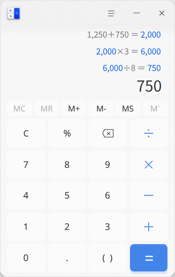
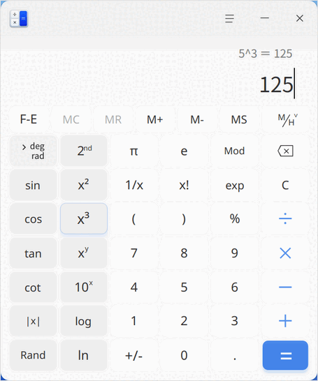
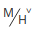
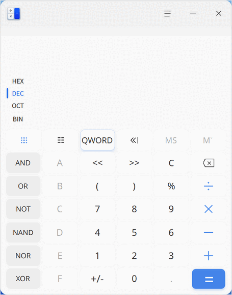
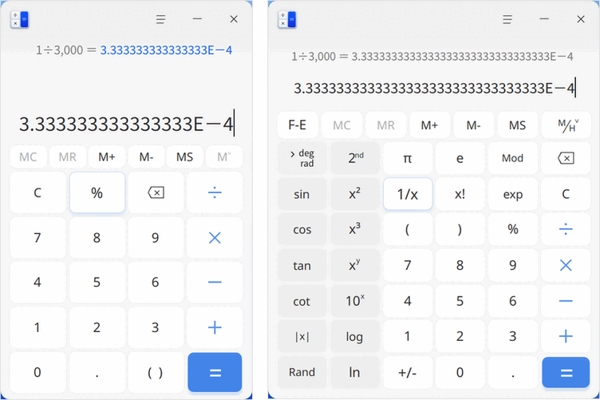
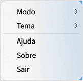

# Calculadora|deepin-calculator|

## Visão geral

A Calculadora é uma ferramenta de desktop completa, com suporte aos modos Padrão, Científico e Programador. Ela oferece suporte completo à entrada pelo teclado, incluindo tolerância a símbolos durante a digitação e vinculação entre expressões e resultados.

## Modos

Na interface da Calculadora, clique em  > **Modo** para:

- Selecionar **Padrão** para alternar para a interface do modo padrão e realizar as operações básicas de adição, subtração, multiplicação e divisão.
- Selecionar **Científico** para alternar para a interface do modo científico e realizar operações avançadas, como funções, exponenciais e raízes.
- Selecionar **Programador** para alternar para a interface do modo programador e realizar cálculos complexos em binário, octal, decimal e hexadecimal.

### Modo Padrão

| Ícone | Nome | Descrição |
| --- | :--- | --- |
| 0~9 | Teclas numéricas | Algarismos arábicos básicos. |
| MC | Tecla de limpeza | Limpa toda a memória. |
| MR | Tecla de memória | Recupera o valor armazenado na memória. |
| M+ | Tecla de memória | Aumenta o valor na memória: soma o valor atual ao conteúdo da memória e interrompe a entrada de dígitos. |
| M- | Tecla de memória | Diminui o valor na memória: subtrai o valor exibido do conteúdo da memória e interrompe a entrada de dígitos. |
| MS | Tecla de memória | Armazena na memória: adiciona o valor do campo de entrada à lista de memória. |
|  | Tecla de memória | Clique em  para expandir a lista de memória e clique novamente para recolhê-la. A memória é zerada quando o aplicativo é fechado. |
| C/AC | Limpar | **C** limpa o conteúdo da expressão atual; **AC** limpa todas as expressões do histórico. |
| % | Porcentagem | Usado para inserir o sinal de porcentagem. |
|  | Apagar | Clique uma vez para apagar um caractere à esquerda. |
| +-×÷ | Adição, subtração, multiplicação e divisão | Operadores matemáticos básicos, usados para realizar adição, subtração, multiplicação e divisão. |
| . | Ponto decimal | Usado para inserir o ponto decimal. |
| () | Parênteses | Usados para inserir parênteses; um clique insere ao mesmo tempo o parêntese esquerdo e o direito. Se você digitar pelo teclado, o parêntese esquerdo insere **(** e o direito insere **)**; se aparecer apenas um dos lados, a expressão estará incorreta. |
| = | Igual | Usado para obter o resultado do cálculo. |

### Modo Científico

| Ícone | Nome | Descrição |
| --- | :--- | --- |
| F-E | Notação científica | Clique em **F-E** para ativar a notação científica e clique novamente para desativá-la. |
|  | Tecla de memória | Exibe a lista de memória e o histórico. |
| // | Conversão de medidas | Calculam em graus, grados e radianos, respectivamente. |
| sin, cos, tan, cot | Funções trigonométricas | Calculam o seno, o cosseno, a tangente e a cotangente do valor inserido. |
| sin-1, cos-1, tan-1, cot-1 | Funções trigonométricas inversas | Clique em **2nd** para alternar para a interface da segunda função; calculam o arco seno, o arco cosseno, o arco tangente e o arco cotangente. |
| &#124;x&#124;, Rand | Funções F | Calculam o valor absoluto do número e exibem aleatoriamente um decimal de 31 dígitos. |
| 2nd | Tecla de segunda função | Clique em **2nd** para alternar para a interface da segunda função e clique novamente para retornar às funções trigonométricas e às operações de potência. |
| x2, x3, xy | Funções de potência | Calculam o quadrado, o cubo e a potência y do valor, respectivamente. |
| 10x, 2x, ex | Funções exponenciais | Calculam 10 elevado a x, 2 elevado a x e e elevado a x, respectivamente. Os botões 2x e ex ficam na interface da segunda função. |
| // | Funções de raiz | Clique em **2nd** para alternar para a interface da segunda função; calculam a raiz quadrada, a raiz cúbica e a raiz y-ésima do valor. |
| log, ln, logyx | Funções logarítmicas | Calculam o logaritmo de base 10, o logaritmo natural e o logaritmo de x na base y. O botão logyx fica na interface da segunda função. |
| π | Pi | Aproximadamente 3,14159..., podendo ser exibido com precisão de até 31 casas decimais. |
| e | Constante de Euler | Aproximadamente 2,71828..., podendo ser exibida com precisão de até 31 casas decimais. |
| Mod | Resto da divisão | Exibe o módulo ou o resto da divisão de x por y. |
| 1/x | Recíproco | Calcula o inverso do valor exibido. |
| x! | Fatorial | Calcula o fatorial do número exibido. |
| exp | Expoente | Permite inserir números representados em notação científica. |

### Modo Programador

| Ícone | Nome | Descrição |
| --- | :--- | --- |
| HEX, DEC, OCT, BIN | Bases numéricas | Hexadecimal, decimal, octal e binário, respectivamente; o decimal é a base padrão. |
|  | Teclado completo | Clique para retornar à interface do teclado completo. |
|  | Teclado de bits | Exibe os bits de 0 a 63 e permite clicar em cada bit. |
| QWORD/DWORD/WORD/BYTE | Tipo de dados | Clique no botão para escolher o modo: quadword (64 bits), double word (32 bits), word (16 bits) e byte (8 bits). |
| /// | Deslocamento | Deslocamento aritmético, deslocamento lógico, deslocamento circular e deslocamento circular com carry, respectivamente. |
| AND, OR, NOT, NAND, NOR, XOR | Operadores lógicos | E, ou, não, não E (NAND), não OU (NOR) e ou exclusivo (XOR), respectivamente. |
| A~F | Letras | Habilitadas apenas no sistema hexadecimal. |
| <<, >> | Operadores de deslocamento | Deslocamento para a esquerda e deslocamento para a direita, respectivamente. |

## Recursos

### Separador de milhar e de dez mil

A Calculadora exibe os números com separador de milhar ou de dez mil. Quando a expressão usa o separador de milhar, clique com o botão direito sobre a área da expressão e escolha **Use o separador de dez mil**; quando a expressão usa o separador de dez mil, clique com o botão direito sobre a área da expressão e escolha **Use o separador de milhar**.

### Tolerância de símbolos

Além dos números e operadores habituais, a Calculadora também aceita variações de símbolos ao digitar expressões pelo teclado, de modo que o estado do método de entrada e o uso de maiúsculas ou minúsculas não afetam a expressão.

A Calculadora também aceita os seguintes símbolos especiais:

- Multiplicação: digitar * (asterisco) ou x (letra x) ativa o sinal de multiplicação;
- Divisão: digitar / ativa o sinal de divisão;
- Adição: digitar + ativa o sinal de adição;
- Subtração: digitar - (hífen) ou _ (sublinhado) ativa o sinal de subtração;
- Porcentagem: digitar % ativa o sinal de porcentagem;
- Ponto decimal: digitar . (ponto final) ou 。 (ponto final do teclado chinês) ativa o ponto decimal;
- Parênteses: digitar o parêntese esquerdo ou o direito ativa os parênteses;
- Igual: digitar **=** ou pressionar **Enter** ativa o sinal de igual;
- Limpar: pressionar **Esc** ativa a limpeza;
- Apagar: pressionar **Backspace** ativa a exclusão;
- Letras: as teclas **A~F** ativam as letras independentemente do estado de maiúsculas ou minúsculas do teclado.

### Expressões

+ Para calcular, clique em **=** na área de entrada da expressão ou pressione **Enter** no teclado. O resultado é exibido no campo de entrada e a expressão é movida para a área de histórico.
+ Reedição: clique em uma expressão do histórico para editá-la novamente. A expressão é exibida na área de entrada; após a edição, pressione **Enter** ou **=** para atualizar a expressão do histórico e o resultado das expressões vinculadas.
+ Erro na expressão: se a expressão digitada estiver incorreta, o cálculo não pode ser concluído e o aplicativo indica erro na expressão.

### Notação científica

Nos modos Padrão e Científico, quando o resultado ultrapassa 16 dígitos (modo Padrão) ou 32 dígitos (modo Científico), ele é exibido em notação científica, ou seja, os primeiros 16 ou 32 dígitos do resultado multiplicados por 10 elevado a n.

+ Quando o resultado é um número inteiro maior que 16 ou 32 dígitos, são exibidos o número com 15 ou 31 casas decimais, seguido de **E** e do expoente.
+ Quando o resultado é um número decimal maior que 16 ou 32 dígitos, são exibidos o número com 15 ou 31 casas decimais, seguido de **E** e do expoente negativo.

### Vinculação de números

- Depois que uma expressão exibe um resultado, você pode continuar digitando operadores. Nesse caso, o primeiro número da nova expressão será o resultado da expressão anterior.

  Por exemplo: a expressão atual é 10 + 20 = 30. Após o resultado 30 ser exibido, digite + e depois o número 9; uma nova expressão 30 + 9 é criada. Pressione **Enter** e o resultado da nova expressão será 39.

- Quando duas expressões ficam vinculadas, alterar os números ou os operadores da expressão anterior afeta o resultado da nova expressão, desde que o resultado da anterior mude.

  Por exemplo: as expressões 10 + 20 = 30 e 30 + 9 = 39 estão vinculadas. Se o operador + da primeira expressão for alterado para x, a conta passa a ser 10 x 20 = 200 e a segunda expressão muda automaticamente para 200 + 9 = 209. Seguindo essa regra, é possível vincular até 9 expressões.

- Ao reeditar uma expressão que contém números vinculados, se o número vinculado for alterado ou se a expressão vinculada ficar incorreta, a vinculação é desfeita e o destaque dos números é removido.

> Observação: a vinculação de números está disponível apenas no modo Padrão.

## Menu principal

No menu principal, você pode alternar o modo de cálculo, alterar o tema da janela, consultar o manual de ajuda e conhecer mais informações sobre a Calculadora.

### Tema

O tema da janela pode ser claro, escuro ou o tema do sistema.

1. Na interface da Calculadora, clique em .
2. Selecione **Tema** e escolha uma cor de tema.

### Ajuda

Consulte o manual de ajuda para conhecer e usar melhor a Calculadora.

1. Na interface da Calculadora, clique em .
2. Selecione **Ajuda**.
3. Consulte o manual de ajuda da Calculadora.

### Sobre

1. Na interface da Calculadora, clique em .
2. Selecione **Sobre**.
3. Consulte a versão e a descrição da Calculadora.

### Sair

1. Na interface da Calculadora, clique em .
2. Selecione **Sair**.
